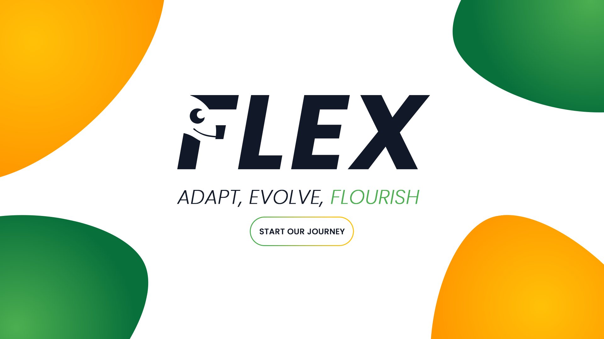
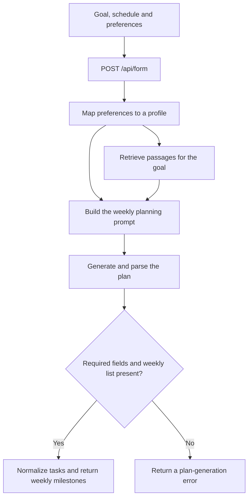
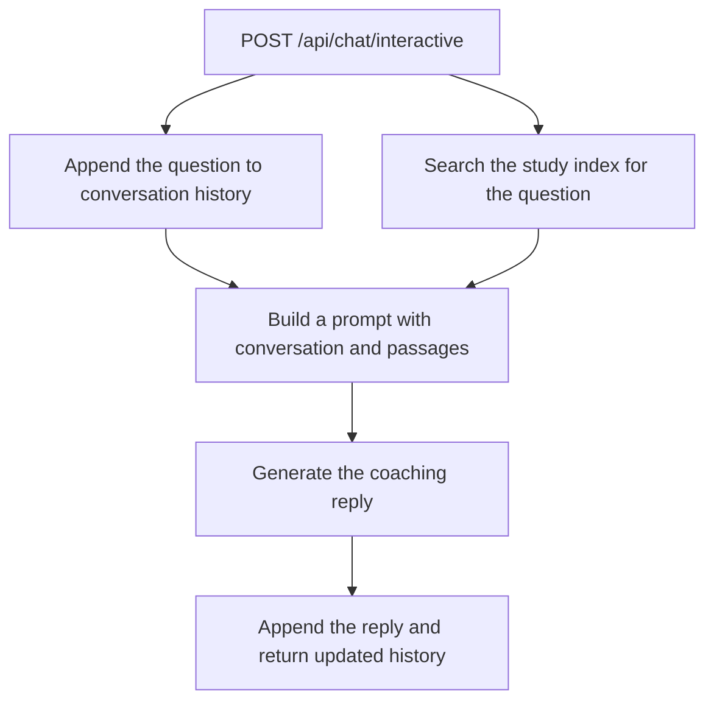

# FLEX AI Life Coach



FLEX is a team graduation project for turning a user's goals and daily schedule into a productivity plan. The React interface pairs a guided planner with a chat assistant. A Python retrieval service searches study materials to give the assistant context for its responses.

## How FLEX builds a weekly plan

The planner combines a goal, the number of weeks available, and work preferences with up to five passages from the study library. The API checks the generated JSON and normalizes the tasks before sending the plan back to the interface.



[Planner endpoint and response checks](src/services/api.py)

## How a follow-up question gets an answer

FLEX uses two sources of context for each reply. Earlier turns tell it what the user has already discussed. A FAISS search over TF-IDF vectors retrieves up to three study passages for the new question.



At startup, FLEX tries to load its saved index. If loading fails, it reads PDFs from `Study_Materials`, splits them into chunks, and saves the rebuilt index. [Retrieval and chat logic](src/services/rag_system.py) · [Vector index](src/services/vector_db.py)

## How the pieces fit

| Component | Where to look |
| --- | --- |
| Planner and chat screens | [React pages](src/pages) |
| HTTP routes and request models | [FastAPI service](src/services/api.py) |
| Document retrieval and model integration | [RAG system](src/services/rag_system.py) |
| Session and message persistence | [SQLite storage](src/services/chat_storage.py) |
| Agent experiments | [Project notebook](Flex_AI_Agent.ipynb) |

## Run locally

From the repository root, create a Python virtual environment, activate it, then run the commands below. Set `GOOGLE_API_KEY` in your local copy of `.env` before starting the API.

```sh
cp .env.example .env
python -m pip install -r requirements.txt
python -m uvicorn src.main:app --reload --port 8000
```

In a second terminal, start the frontend and open the URL Vite prints.

```sh
npm ci
npm run dev
```

## 👥 Team

- Mohamed Wael
- Kareem Nagah
- Mohamed Amr
- Amr Amgad
- Youssef Alsebaey
- Loay Ayman
- Abdallah Elhosseny
- Salma Gamal
- Tasneem Osama

